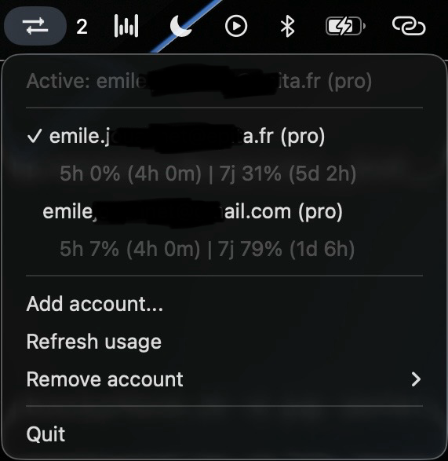

# Claude/Codex Account Switcher

[](https://github.com/hai20112003/claude-account-switcher/releases)
[](https://github.com/hai20112003/claude-account-switcher/releases/latest)
[](#requirements)
[](#windows)

Switch between multiple Claude Code and Codex CLI accounts from your macOS menu bar or the Windows system tray.

Claude Switcher keeps separate account sessions for Claude Code and Codex CLI, shows live usage, and can automatically switch to another saved account when a provider reaches its limit.



## Why use it?

AI coding CLIs are great until you need to jump between personal, work, team, or backup accounts. Without this app, switching usually means logging out, opening a browser, logging back in, and interrupting whatever you were doing in the terminal.

Claude Switcher stores account backups in macOS Keychain and swaps the active CLI session in one click. Claude and Codex are handled independently, so the active Claude account never changes your active Codex account.

## Features

- **Claude Code account switching** - swap saved Claude Code sessions instantly
- **Codex CLI account switching** - save and restore Codex `auth.json` sessions
- **Provider-separated state** - same email can exist once for Claude and once for Codex
- **Live usage in the menu bar** - Claude 5-hour/7-day windows and Codex primary/secondary windows
- **Optional auto-switch** - per-provider failover when active usage reaches 100%
- **First-launch import** - imports the currently logged-in Claude and Codex accounts when available
- **macOS Keychain backups** - saved credentials are stored in Keychain, not plaintext config
- **Standalone `.app` build** - no Python install required for normal users

## Install

### GitHub release

1. Open the [latest release](https://github.com/hai20112003/claude-account-switcher/releases/latest)
2. Download `Claude-Switcher-vX.Y.Z.zip`
3. Unzip it and drag **Claude Switcher.app** to `/Applications`
4. Launch it. The app appears as a menu bar icon.

On first launch, macOS may block the app because it is not signed. Open **System Settings -> Privacy & Security** and click **Open Anyway**.

## Usage

Open the menu bar icon to:

- click any Claude or Codex account to make it active
- add a Claude account with `claude auth login`
- add a Codex account with a visible Terminal-based `codex login` flow
- refresh live usage manually
- enable or disable auto-switch separately for Claude and Codex
- remove saved inactive accounts from Keychain

After switching Claude, verify from any terminal:

```bash
claude auth status
```

After switching Codex, verify with:

```bash
codex login status
```

## How it works

Claude Code stores OAuth credentials in macOS Keychain under `Claude Code-credentials` and account metadata in `~/.claude.json`. Claude Switcher backs up each saved Claude account under `claude-switcher:{email}`, then restores the selected backup into Claude Code's active credential slot and updates `~/.claude.json`.

Codex CLI stores ChatGPT authentication in `~/.codex/auth.json` when `cli_auth_credentials_store = "file"` is used. Claude Switcher backs up each saved Codex session under `codex-switcher:{email}` and restores the selected session back to `~/.codex/auth.json` with `0600` permissions.

Auto-switch is disabled by default. When enabled, usage refreshes in the background and the app switches only within the same provider. A full Claude account switches to another Claude account; a full Codex account switches to another Codex account.

### Architecture

```text
macOS Keychain
├── Claude Code-credentials       active Claude token
├── claude-switcher:user1@...     saved Claude account
├── claude-switcher:user2@...     saved Claude account
├── codex-switcher:user1@...      saved Codex auth.json
└── codex-switcher:user2@...      saved Codex auth.json

~/.claude.json
└── oauthAccount                  swapped on Claude account switch

~/.codex/auth.json
└── tokens                        swapped on Codex account switch

~/.config/claude-switcher/accounts.json
└── provider, email, plan, active state, settings
```

## Windows

The Windows version is a system tray app with the same menu: accounts with live usage, add, switch, remove, auto-switch, plus **Start with Windows**.

### Install

1. Download `Claude-Switcher-Windows-vX.Y.Z.zip` from the [latest release](https://github.com/hai20112003/claude-account-switcher/releases/latest)
2. Unzip and run `ClaudeSwitcher.exe` (no Python needed). Windows SmartScreen may warn because the exe is not signed: click **More info -> Run anyway**.
3. The icon appears in the system tray (it may be under the `^` overflow arrow). Right-click it to open the menu.

Adding a Claude account opens a console window running `claude auth login`; adding a Codex account opens one running `codex login`. After switching, start a new `claude` session and check with `claude auth status`.

### How it works on Windows

Claude Code on Windows stores its session in `%USERPROFILE%\.claude\.credentials.json` (or `%CLAUDE_CONFIG_DIR%\.credentials.json`) instead of a Keychain. That file also holds MCP server tokens, so a switch replaces only the `claudeAiOauth` entry and leaves everything else in the file untouched.

```text
%USERPROFILE%\.claude\.credentials.json
└── claudeAiOauth                 swapped on Claude account switch (MCP tokens kept)

%APPDATA%\claude-switcher\vault\*.bin
└── one DPAPI-encrypted backup per saved Claude or Codex account

%USERPROFILE%\.claude.json, %USERPROFILE%\.codex\auth.json,
%USERPROFILE%\.config\claude-switcher\accounts.json
└── same role as on macOS
```

Backups are encrypted with Windows DPAPI for the current user, so another Windows user or another machine cannot decrypt them. Background CLI calls run without a console window; only login opens one.

## Codex setup note

Codex keyring storage is detected but not switched in this release. When adding a Codex account, the app opens Terminal and runs Codex login with file-mode credentials. You can also configure file mode explicitly:

```toml
# ~/.codex/config.toml
cli_auth_credentials_store = "file"
```

Then run:

```bash
codex login
```

If a saved Codex session expires because its refresh token was already rotated, the app refuses to restore that stale session and shows **Login required** for usage. Add that Codex account again to refresh the saved Keychain backup.

## Security

- Saved account backups are stored in macOS Keychain
- The app config stores metadata only and is written with `0600` permissions
- The config directory is written with `0700` permissions
- Email validation prevents Keychain service-name injection
- On Windows, saved account backups are DPAPI-encrypted files readable only by the same Windows user
- Subprocess calls do not use `shell=True`
- Network usage checks run with short timeouts in background workers
- Keychain reads/writes use short timeouts so the menu bar UI does not hang indefinitely

## Requirements

- macOS 12 or later, or Windows 10/11
- Claude Code CLI for Claude account switching
- Codex CLI for Codex account switching
- Codex file-mode credentials for Codex switching in this version

## Build from source

```bash
git clone https://github.com/hai20112003/claude-account-switcher.git
cd claude-account-switcher
python3 -m venv .venv
source .venv/bin/activate
pip install -e ".[dev]"
```

Run directly:

```bash
claude-switcher
```

Build the standalone app:

```bash
bash build_app.sh
# Output: dist/Claude Switcher.app
```

Build the Windows exe (PowerShell, on Windows):

```powershell
.\build_windows.ps1
# Output: dist\ClaudeSwitcher.exe
```

Run tests:

```bash
pytest tests/ -q
```

## Release artifacts

- macOS: `Claude-Switcher-vX.Y.Z.zip` containing `Claude Switcher.app` (built with `build_app.sh`)
- Windows: `Claude-Switcher-Windows-vX.Y.Z.zip` containing `ClaudeSwitcher.exe`, built and attached to the release by the GitHub Actions workflow when a `v*` tag is pushed

## Credits

Based on the macOS app [claude-account-switcher](https://github.com/Symbioose/claude-account-switcher) by Emile Jouannet (MIT). Windows support added in this repository.

## License

MIT, see [LICENSE](LICENSE).
